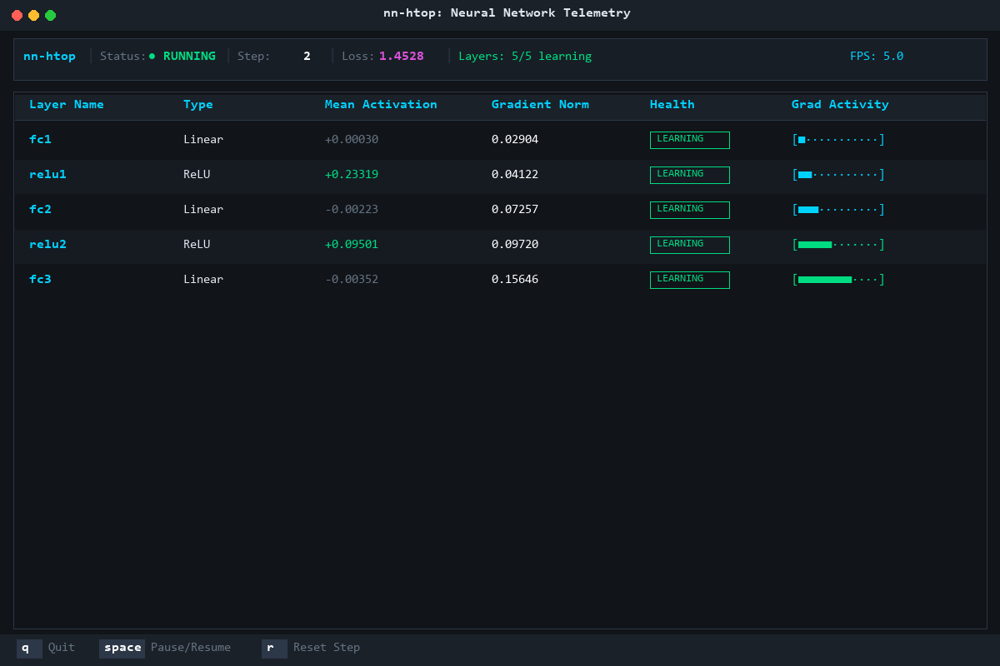

# nn-htop

A terminal-based monitor for PyTorch neural network layer activations and gradient norms (htop for PyTorch neural networks).

## Installation

```bash
pip install nn-htop
```

## Quickstart

Run the built-in demonstration harness (a 3-layer MLP training on synthetic tensor batches):

```bash
nn-htop
```

## Integration

Attach `Monitor` to any `torch.nn.Module` using context-managed hook lifecycle and launch the non-blocking Textual interface:

```python
import torch
import torch.nn as nn
from nn_htop import Monitor, launch_tui

model = nn.Sequential(
    nn.Linear(128, 64),
    nn.ReLU(),
    nn.Linear(64, 10),
)

with Monitor(model) as monitor:
    # Launches Textual TUI; non-blocking telemetry reads at 5 FPS
    launch_tui(monitor)
```

### Manual Training Loop Integration

If integrating into an existing custom training workflow:

```python
import threading
from nn_htop import Monitor, launch_tui

model = MyCustomModel()

with Monitor(model) as monitor:
    # Monitor registers full backward hooks and forward hooks on all leaf layers.
    # Metrics (mean activation, L2 gradient norm) are stored in a thread-safe state dictionary.
    launch_tui(monitor, train_fn=my_training_loop)
```

## Architecture

- **Hook Instrumentation**: Attaches `register_forward_hook` (mean activation tracking) and `register_full_backward_hook` (L2 gradient norm) to leaf modules. Automatically overrides `inplace=True` during monitoring to prevent autograd graph conflicts.
- **Memory Safety**: Tensors are detached and reduced to Python floats immediately inside hook callbacks to eliminate computational graph retention.
- **Decoupled Telemetry**: PyTorch training threads write strictly to atomic state dictionaries; the UI polls via `set_interval(0.2)` at 5 FPS to guarantee zero impact on training throughput.
